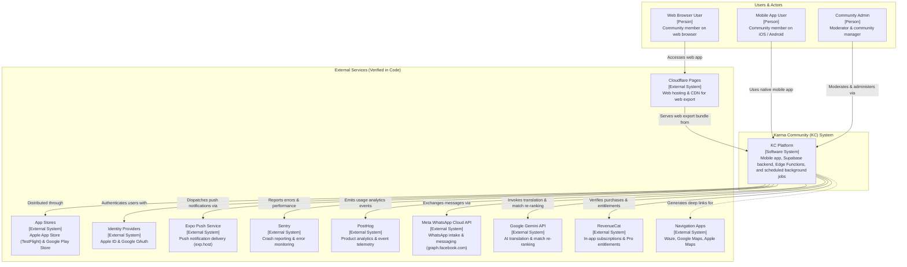

# Current architecture (from the code, 2026-10-30)

## Overview
```
app/ (pnpm + turbo monorepo)
├── apps/mobile                 Expo + React Native + expo-router (typed routes); web export; Hebrew RTL forced
└── packages/
    ├── domain                  Entities, value objects, pure rules (no I/O)
    ├── application             Use cases + ports (interfaces)
    ├── infrastructure-supabase Adapters implementing ports on Supabase
    └── ui                      Design tokens & shared components (@kc/ui)
supabase/
├── migrations/                 Sequential NNNN_snake.sql (latest: 0531_ride_series.sql)
└── functions/                  Edge Functions (Deno)
.github/workflows/              CI gate + lanes, gated Deploy + stages, nightly mobile builds
```
Dependency direction is strictly inward: `apps/mobile → application → domain`; `infrastructure-supabase` implements `application` ports. App semver: `app/VERSION` (PATCH bumped automatically on every merge into `dev`, `bump-version-on-merge.yml`).

## C4 Context diagram

The C4 System Context diagram illustrates the boundary of the Karma Community (KC) platform, the primary user personas who interact with it, and the verified external systems integrated into the application.



## C4 Container diagram

The C4 Container diagram zooms into the KC system, illustrating the composition root (`apps/mobile`), monorepo package layers, Supabase backend containers (PostgreSQL, Auth, Storage, Edge Functions), background schedulers, and interactions with external platforms.

```mermaid
flowchart TB
  subgraph Users ["Users"]
    UserMobile["Mobile User\n(iOS / Android)"]
    UserWeb["Web User\n(Browser)"]
  end

  subgraph ClientContainer ["Client Container: apps/mobile (Expo & Web Build)"]
    direction TB
    ExpoRouter["Expo Router Screens\n(apps/mobile/app/**)"]
    MobileSrc["Mobile Application Core\n(apps/mobile/src/**: components, hooks, stores)"]
    
    subgraph ClientLayers ["Internal Monorepo Packages"]
      direction TB
      PkgUI["@kc/ui\nDesign tokens, theme & UI primitives"]
      PkgDomain["@kc/domain\nEntities, value objects, pure domain logic"]
      PkgApp["@kc/application\nUse cases & repository/service ports"]
      PkgInfra["@kc/infrastructure-supabase\nAdapters, repos, Supabase client, DB types"]
    end
    
    ClientObservability["Client Observability & SDKs\nSentry, PostHog, RevenueCat, Expo Notifications"]
  end

  subgraph WebDelivery ["Web Hosting Container"]
    CFPages["Cloudflare Pages\nStatic asset hosting & CDN for web export"]
  end

  subgraph SupabasePlatform ["Supabase Backend Platform (kc-dev / kc-prod)"]
    direction TB
    
    subgraph SupabaseDB ["PostgreSQL Database"]
      PostgresSchema["Postgres Tables & Views\n(posts, listings, rides, chats, karma, profiles, entitlements)"]
      RLSPolicies["Row Level Security (RLS)\nGranular table-level security policies"]
      DBRpcs["Database Stored Procedures\nSECURITY DEFINER RPCs (public grants revoked)"]
      RealtimeEngine["Supabase Realtime\nPostgres changes, broadcast channels, presence"]
    end
    
    SupaAuth["Supabase Auth\nJWT management, user sessions, Apple/Google OAuth"]
    SupaStorage["Supabase Storage\nBuckets for media, avatars, attachments (storage RLS)"]
    
    subgraph EdgeFunctions ["Supabase Edge Functions (Deno Runtime)"]
      FnNotify["dispatch-notification\nOutbox worker & push dispatcher"]
      FnWhatsApp["whatsapp-webhook / sender / worker\nWhatsApp Cloud API bridge & intake bot"]
      FnTranslate["translate\nAI content translation worker"]
      FnMatching["match-rerank & embed-worker\nSemantic matching & vector embeddings"]
      FnRevenueCat["revenuecat-webhook\nPro entitlement sync handler"]
      FnPayments["payments-webhook / subscriptions-charger\nPayments intake, standing-order charging"]
      FnMaintenance["purge-deleted-accounts / strip-exif / thumbs / reconcile\nAccount purge after the grace period & media storage maintenance"]
      FnShared["_shared/\nObservability, CORS, serviceRoleGuard"]
    end
  end

  subgraph ScheduledJobs ["Scheduled Background Jobs"]
    direction TB
    PgCron["PostgreSQL pg_cron Schedulers\nmatching_v2_sweep, ride_series_sweep, ride_route_alerts_sweep,\nride_bookings_expire_sweep, posts_relevance_reminders_daily,\nclosure_cleanup_daily, storage_orphan_reconciliation"]
    GHActions["GitHub Actions Cron Workflows\nmobile-nightly, e2e-nightly-dev, ci-migration-drift, ops-health,\nissue-claims, close-issues-on-dev-merge, stale-stack-report"]
  end

  subgraph ExternalServices ["External Services"]
    ExtExpoPush["Expo Push Service\n(exp.host)"]
    ExtSentry["Sentry"]
    ExtPostHog["PostHog"]
    ExtWhatsApp["Meta WhatsApp Cloud API\n(graph.facebook.com)"]
    ExtGemini["Google Gemini API\n(generativelanguage.googleapis.com)"]
    ExtRevenueCat["RevenueCat API"]
    ExtOAuth["Google & Apple OAuth"]
    ExtStores["Apple App Store & Google Play"]
  end

  UserMobile -->|"Uses native app"| ExpoRouter
  UserWeb -->|"Visits web app via HTTPS"| CFPages
  CFPages -->|"Serves client bundle to"| UserWeb
  
  ExpoRouter --> MobileSrc
  MobileSrc --> PkgUI
  MobileSrc --> PkgApp
  MobileSrc --> PkgDomain
  MobileSrc --> PkgInfra
  PkgApp --> PkgDomain
  PkgInfra --> PkgApp
  PkgInfra --> PkgDomain

  PkgInfra -->|"Queries & mutations (PostgREST / RPC)"| SupabaseDB
  PkgInfra -->|"Realtime event subscriptions"| RealtimeEngine
  PkgInfra -->|"Auth state & sessions"| SupaAuth
  PkgInfra -->|"Media upload / download"| SupaStorage
  
  ClientObservability -->|"Reports client crashes"| ExtSentry
  ClientObservability -->|"Sends user telemetry"| ExtPostHog
  ClientObservability -->|"Syncs user purchases"| ExtRevenueCat
  SupaAuth -->|"Validates OAuth tokens"| ExtOAuth

  PgCron -->|"Executes periodic maintenance SQL"| DBRpcs
  PgCron -->|"Invokes cleanup Edge Functions via pg_net"| FnMaintenance
  GHActions -->|"Builds & uploads binary releases"| ExtStores
  GHActions -->|"Runs E2E smoke tests against"| CFPages
  GHActions -->|"Audits schema drift against"| SupabaseDB

  FnNotify -->|"Sends push payloads"| ExtExpoPush
  FnWhatsApp -->|"Sends & receives WhatsApp messages"| ExtWhatsApp
  FnTranslate -->|"Translates user content"| ExtGemini
  FnMatching -->|"Re-ranks matching pairs"| ExtGemini
  ExtRevenueCat -->|"Posts subscription webhooks"| FnRevenueCat
  
  FnNotify -->|"Fetches outbox & updates dispatch status"| SupabaseDB
  FnWhatsApp -->|"Persists messages & creates intake listings"| SupabaseDB
  FnTranslate -->|"Reads & caches content translations"| SupabaseDB
  FnMatching -->|"Reads listings & updates match_candidates"| SupabaseDB
  FnRevenueCat -->|"Calls api_revenuecat_set_pro RPC"| DBRpcs
  FnPayments -->|"Updates payments & standing orders"| SupabaseDB
  FnMaintenance -->|"Deletes account records & cleans orphans"| SupabaseDB
  FnMaintenance -->|"Removes deleted files"| SupaStorage
  FnShared -->|"Sends function crash envelopes"| ExtSentry
```



## Package and module boundaries

The package boundaries and import directions in the monorepo are enforced by `app/scripts/check-architecture.mjs` (executed locally via `pnpm lint:arch` and on every PR via the `ci-static-guards` CI check). Violations fail the build immediately.

```
apps/mobile  ──▶  infrastructure-supabase  ──▶  application  ──▶  domain
     │                                               ▲
     ├─── (direct use-case calls & composition) ─────┤
     │
     └─── (renders shared primitives) ──▶  ui (isolated)
```

| Package / Module | Path | Architectural role | Allowed inward imports | Forbidden imports (enforced by `check-architecture.mjs`) | Additional enforced invariants |
|---|---|---|---|---|---|
| **`packages/domain`** (`@kc/domain`) | `app/packages/domain/src/**` | Pure domain entities, value objects, domain errors, and business rules. Zero dependencies on `node_modules` (except `typescript` dev-dep). No I/O, no network, no framework code. | Internal domain modules (`./*`, `../..`) only | `@kc/infrastructure-supabase`, `@supabase/*`, `@kc/application`, `@kc/ui` | No raw `throw new Error(...)` — must throw typed domain error class from `errors.ts` (`DOMAIN_ERROR_RULE`); file size cap ≤ 300 LOC. |
| **`packages/application`** (`@kc/application`) | `app/packages/application/src/**` | Application use cases (one per file), repository and service ports (`I*.ts` interfaces), and notification coalesce logic. Pure TypeScript: no I/O, no Supabase, no React. | `@kc/domain`, internal application modules | `@kc/infrastructure-supabase`, `@supabase/*`, `@kc/ui` | `coalesce.ts` must exactly mirror `supabase/functions/dispatch-notification/coalesce.ts` (`checkNotificationsCoalesceMirror`); file size cap ≤ 300 LOC. |
| **`packages/infrastructure-supabase`** (`@kc/infrastructure-supabase`) | `app/packages/infrastructure-supabase/src/**` | Adapters implementing application ports (`I*Repository`, `I*Service`), Supabase client bootstrap, generated database types (`database.types.ts`). Owns network, Supabase SDK, and storage interactions. | `@kc/application` (to implement ports), `@kc/domain` (for domain models/errors), `@supabase/supabase-js`, external infra libraries | Forbidden from being imported by `domain`, `application`, or `ui` | Adapters only implement ports; never imported by inner layers; file size cap ≤ 300 LOC (excluding generated `database.types.ts`). |
| **`packages/ui`** (`@kc/ui`) | `app/packages/ui/src/**` | Design tokens (colors, typography, spacing), theme support, and shared reusable React Native UI primitives. Independent design system. | React Native primitives, internal UI components | `@kc/infrastructure-supabase`, `@supabase/*`, `@kc/application`, `@kc/domain` | Zero dependencies on business rules or backend layers; file size cap ≤ 300 LOC. |
| **`apps/mobile`** (`@kc/mobile`) | `app/apps/mobile/**` | Composition root (Expo + React Native + expo-router). Instantiates infrastructure adapters, injects them into application use cases, connects to React state, mounts `@kc/ui` components, and manages client routing. | `@kc/ui`, `@kc/domain`, `@kc/application`, `@kc/infrastructure-supabase`, `@supabase/supabase-js`, React Native, Expo, external SDKs (Sentry, PostHog, RevenueCat) | Direct SQL or bypassing port/adapter abstractions | Route hygiene: files under `apps/mobile/app/` must default-export a screen component (non-screens belong in `src/`); file size cap ≤ 300 LOC (allowlist tracked). |

## External services (verified in code)

Every external service listed below has been verified in code; unverified or hypothetical integrations are omitted:

| Service | Provider / Platform | Where used in code | Purpose |
|---|---|---|---|
| **Sentry** | Sentry SDK & HTTP Ingest | `app/apps/mobile/src/lib/observability/sentry.ts`, `app/apps/mobile/package.json` (`@sentry/react-native`), `supabase/functions/_shared/observability/` | Application crash reporting, unhandled exceptions, and performance tracing across mobile client and Edge Functions. |
| **PostHog** | PostHog React Native SDK | `app/apps/mobile/src/lib/observability/posthog.ts`, `app/apps/mobile/src/lib/analytics.ts`, `app/apps/mobile/package.json` (`posthog-react-native`) | Product analytics, user behavior telemetry, and feature funnel conversion tracking (no-op when unconfigured in dev). |
| **Expo Push Service** | Expo Application Services | `app/apps/mobile/src/lib/notifications/register.ts` (`expo-notifications`), `supabase/functions/dispatch-notification/expoPushClient.ts` | Remote push notification token registration on devices and backend notification delivery via `https://exp.host/--/api/v2/push/send`. |
| **App Stores** | Apple App Store & Google Play Store | `.github/workflows/testflight-ios.yml`, `.github/workflows/play-internal.yml`, `.github/workflows/mobile-nightly.yml`, `app/apps/mobile/eas.json` | Binary distribution for internal testing and staging releases (TestFlight iOS, Google Play Console internal track) via Expo EAS. |
| **Apple & Google Auth** | Apple ID & Google Identity | `app/apps/mobile/src/services/authComposition.ts` (`expo-apple-authentication`), Supabase Auth OAuth provider | Social sign-in and authentication identity verification for mobile and web users. |
| **Meta WhatsApp Cloud API** | Meta Graph API | `supabase/functions/whatsapp-sender/`, `supabase/functions/whatsapp-webhook/`, `supabase/functions/whatsapp-intake-worker/`, `supabase/functions/_shared/whatsapp/meta.ts` (`https://graph.facebook.com`) | Inbound WhatsApp webhook processing, bot conversation intake, community message bridging, and outbound notifications. |
| **Google Gemini API** | Google Generative Language | `supabase/functions/match-rerank/handler.ts`, `supabase/functions/_shared/translation/gemini.ts`, `supabase/functions/_shared/whatsapp/agent/gemini.ts` | LLM inference for multilingual content translation, semantic match candidate re-ranking, and conversational WhatsApp intake parsing. |
| **RevenueCat** | RevenueCat SDK & Webhook | `app/apps/mobile/src/services/purchases/revenuecat.ts` (`@revenuecat/purchases-js` / hybrid mappings), `supabase/functions/revenuecat-webhook/` | In-app subscription lifecycle management and synchronization of Pro tier status to the `public.user_entitlements` database table. |
| **Cloudflare Pages** | Cloudflare Edge Hosting | `.github/workflows/deploy.yml` (`cloudflare/pages-action`), `docs/SSOT/ENVIRONMENTS.md` | Static web export hosting, preview deployments for pull requests, and edge delivery for web users (`dev.karma-community.pages.dev`). |
| **Navigation Apps** | Waze, Google Maps, Apple Maps | `app/packages/domain/src/rides/rideNavigation.ts`, `app/apps/mobile/src/components/marketplace/RideRouteStops.tsx` | Native deep-linking for turn-by-turn navigation between ride pickup/dropoff coordinates. |

## Scheduled & background jobs

KC relies on two scheduling planes: database-level `pg_cron` jobs running directly within Postgres, and GitHub Actions cron workflows for CI/CD, testing, and operational audits.

### Database `pg_cron` jobs (Supabase Postgres)

| Job name | Schedule | Target / Logic | Purpose |
|---|---|---|---|
| `matching_v2_sweep` | `*/10 * * * *` (every 10m) | `public.match_run_sweep()` | Expires stale match candidates, computes new candidate pairs across listings, and flags pending notifications. |
| `ride_series_sweep` | `*/10 * * * *` (every 10m) | `public.ride_series_sweep()` | Materializes upcoming recurring ride instances from active recurring ride templates. |
| `ride_route_alerts_sweep` | `*/10 * * * *` (every 10m) | `public.ride_route_alerts_sweep()` | Scans saved passenger routes and generates alert notifications for newly matched driver listings. |
| `ride_bookings_expire_sweep` | `*/15 * * * *` (every 15m) | `public.ride_bookings_expire_sweep()` | Sweeps and expires unconfirmed or stale ride booking requests past their departure threshold. |
| `posts_relevance_reminders_daily` | `0 6 * * *` (daily 06:00 UTC) | `public.posts_relevance_reminders_sweep()` | Sends push/inbox reminders to post authors to verify if their open listings remain active. |
| `closure_cleanup_daily` | `0 2 * * *` (daily 02:00 UTC) | `public.closure_cleanup_sweep()` | Archives and finalizes abandoned or unmarked post closures. |
| `notifications_backlog_daily` | `0 6 * * *` (daily 06:00 UTC) | `public.notifications_backlog_alert()` | Audits notification outbox for stuck or retried entries and flags dispatch backlog issues. |
| `storage_orphan_reconciliation` | `0 5 * * *` (daily 05:00 UTC) | Triggers `reconcile-storage-orphans` via `pg_net` | Detects and cleans up orphaned file uploads in storage buckets that lack corresponding database rows. |
| `suspension_expiry_daily` | `0 3 * * *` (daily 03:00 UTC) | `public.suspension_expiry_sweep()` | Lifts temporary user suspensions whose expiry timestamp has elapsed. |
| `purge_user_active_days` | `0 4 * * *` (daily 04:00 UTC) | `delete from user_active_days ...` | Data retention enforcement: purges daily activity tracking rows older than the retention window. |
| `purge_cron_run_details` | `0 4 * * *` (daily 04:00 UTC) | `delete from cron.job_run_details ...` | Maintenance cleanup: purges `pg_cron` execution log records older than 7 days. |

### GitHub Actions scheduled cron workflows

| Workflow | File | Schedule | Purpose |
|---|---|---|---|
| `mobile-nightly` | `.github/workflows/mobile-nightly.yml` | `43 23 * * *` (nightly) | Builds the latest green `dev` commit with EAS and dispatches tester builds to TestFlight iOS and Google Play internal track. |
| `e2e-nightly-dev` | `.github/workflows/e2e-nightly-dev.yml` | `0 1 * * *` (nightly) | Executes end-to-end Playwright tests against `dev.karma-community.pages.dev` and `kc-dev`. |
| `ci-migration-drift` | `.github/workflows/ci-migration-drift.yml` | `17 */6 * * *` (every 6h) | Verifies schema consistency between the `supabase/migrations/` ledger and the active `kc-dev` database. |
| `ops-health` | `.github/workflows/ops-health.yml` | `23 * * * *` (hourly) | Probes public API health and web endpoints to detect service degradations. |
| `issue-claims` | `.github/workflows/issue-claims.yml` | `23 * * * *` (hourly) | Releases stale agent issue claims older than 6 hours without active pull requests. |
| `dependency-audit` | `.github/workflows/dependency-audit.yml` | `41 2 * * *` (daily) | Audits every lockfile and Edge Function npm import on `dev` and `main` against the npm advisory database; keeps one tracking issue open while it fails (#1373). |
| `close-issues-on-dev-merge` | `.github/workflows/close-issues-on-dev-merge.yml` | `17 3 * * *` (daily) | Reconciles issues closed by merged PRs into the `dev` branch. |
| `stale-stack-report` | `.github/workflows/stale-stack-report.yml` | `0 6 * * 0` (weekly Sundays) | Generates a report of open branches and pull requests across stacked development branches. |

## Backend: Supabase
- Auth (Google, Apple, email/password; guest mode), Postgres with RLS, Storage, Realtime, Edge Functions. Phone is a **verification** status (migration `0068`), not a sign-in method yet (legacy `TD-151`).
- **Two projects:** `kc-dev` (integration; also used by `staging`) and `kc-prod` (production). Seed data **only** in `kc-dev` (D8). Project refs/keys live in GitHub Environments (`supabase-dev`, `supabase-prod`) and are referenced by name only.
- Schema changes reach any DB **only** as committed migration files applied via `supabase db push` / the database stage of the **Deploy** workflow (after a green push CI run on `dev`/`main`; prod also needs the owner's approval). Never via ad-hoc MCP `apply_migration`. Drift is checked by `ci-migration-drift`.

### Edge Functions (by purpose)
| Area | Functions |
|---|---|
| Account | `purge-deleted-accounts` (daily job `account_purge`; deletion itself is the `request_account_deletion` RPC) |
| Notifications | `dispatch-notification` |
| Matching | `embed-worker`, `match-rerank` |
| Media | `strip-exif`, `backfill-image-thumbs`, `reconcile-storage-orphans` |
| Money | `payments-webhook`, `subscriptions-charger`, `revenuecat-webhook`, `validate-donation-link` |
| WhatsApp | `whatsapp-intake-worker`, `whatsapp-sender`, `whatsapp-webhook` |
| Research & i18n | `public-research-submit`, `rotate-research-salt`, `translate` |
| Shared | `_shared/` |

### Core data (as-is)
- Content lives in **both** `posts` and `listings` (with sync triggers), plus `ride_listings` and `giving_handoffs` — three state machines. Unification plan: [ADR-006](./adr/ADR-006-one-post-model.md). Step 1 shipped (`0551`–`0553`): `posts` carries every listing column (`world_slug`, `direction`, `post_type`, `expires_at`, `source`, `details`, …) and the `paused` status; `ride_post_details` and `post_handoffs` mirror the ride details and `giving_handoffs` by trigger. Step 2 shipped (`0554`): for food, rides, housing and time the RPCs write `posts` and derive the listing (`origin = native`, `legacy_post_id`), with the listing-side rules still enforced on the derived row and their results synced back; items stay on the post engine with the legacy `origin = post` listing. Step 3a shipped (`0555`): the items / food handoff RPCs and sweeps write `post_handoffs`; `giving_handoffs` is derived from it, both directions guarded. Step 3b shipped (`0556`): the ride / knowledge booking RPCs and readers accept a post id; their record stays `giving_handoffs` (mirrored into `post_handoffs` by 0553) until every listing of a handoff world has a post — step 3b-pre (`0557`) gave every published open listing a post from publication, with `posts.feed_hidden` keeping a knowledge offer's post (until shared) and a recurring ride's later occurrences (until their turn) out of the main feed — the feed view, the ranked RPC, the new-post broadcast, the activity log and the app's simple query honour the flag; step 3b″ (`0558`) moved the ride and knowledge booking writers to `post_handoffs`; step 3b‴ (`0610`) moved the housing writers and the generic cancel, so every handoff writer now writes `post_handoffs` and `giving_handoffs` is only a derived copy (still read by the readers, the housing details FK and the ratings FK until step 6). Step 3c (`0559`) closes a handed-over post-form item through its post (G34). Step 4a: `/post/[id]` is the detail screen of every listing-world post (the listing's sections and actions embedded, likes and comments added) and the listing routes forward to it. Step 5a (`0563`): an organization's event is a time-world post (`org_event` kind) with the 1:1 `event_post_details`; its registrations live only in `post_handoffs` (not mirrored into `giving_handoffs`). Step 5b: the time world's offer form publishes the event for a member of an organization, and the post page carries its registration and the organizer's roster; the organizer's volunteer-opportunity create screen is retired. The older volunteering tables (`volunteer_opportunities`, `volunteer_shifts`, `volunteer_shift_signups`, `0370`) stay for the existing organizer screens until step 6. `world_slug` + `MARKETPLACE_WORLD_SLUGS`; `listing_kinds`; `public.categories`.
- Karma: `karma_ledger`, values hard-coded (migration 0099).
- Ratings: `ride_ratings`, `giving_handoff_ratings` (currently readable via RLS; spec says admin-only — G4).
- Engagement: likes/comments (migration 0250). Chat: one conversation per pair with pinned post. Moderation: `reports` + suspects queue. Orgs: `donation_links`. Matching: `match_candidates` (MATCHING_V2).
- World launch flags (migration 0441); rides world exists behind a flag.

## Environments & delivery
| Branch | Role | Web | Supabase |
|---|---|---|---|
| `main` | production | Cloudflare Pages (prod domain) | kc-prod |
| `dev` | integration (default PR base) | Cloudflare Pages (dev) | kc-dev |
| `staging` | optional pre-integration | Cloudflare Pages (staging) | kc-dev |

- `dev` must contain `main`'s history: after each `main` push `sync-main-to-dev.yml` opens a zero-diff `-s ours` PR into `dev`, which the owner merges as a merge commit with the admin bypass because the `dev` merge queue only squashes (`TD-182`). `main`-only file changes must reach `dev` by their own PR. `main` advances only via PR `dev → main`. No force-push, no branch deletion.
- **PR CI:** `ci` — one required check, `CI gate` (`D-195`), over the lanes `ci-pr`, `ci-static-guards`, `ci-frontend` (+ `ci-sonar`), `ci-backend`, `ci-edge-functions` and, for PRs into `main`, `ci-release`; plus `ci-migration-drift` and security scanners (GitGuardian, Snyk).
- **Deploy:** `deploy` only (after a green push CI run; prod behind one owner approval), with stages `deploy-db`, `deploy-functions`, `deploy-web`, `deploy-smoke`, `deploy-tag`, `deploy-rollback` (`D-195`).
- **Mobile:** `mobile-nightly` builds the newest green `dev` commit and calls `testflight-ios` and `play-internal` (no push trigger); `kc-mobile-eas-preview` is manual. Tester builds use kc-dev through the eas.json `nightly` profile and the `mobile-store` environment key, and a bundle pointing anywhere else is not uploaded (`D-195`, [`../SSOT/ENVIRONMENTS.md`](../SSOT/ENVIRONMENTS.md) § Production release). Public store release is currently paused.
- Nightly/ops: `e2e-nightly-dev`, `k6-load-dev`, `db-explain-dev`, `seed-kc-dev`, `stale-stack-report`.

## Known structural gaps vs spec
See [`../spec/93_implementation_gaps.md`](../spec/93_implementation_gaps.md) — notably G1 (posts/listings unification), G2/G24 (world list & domains), G14 (form per type), G16 (karma config), G23 (world hub infra).
