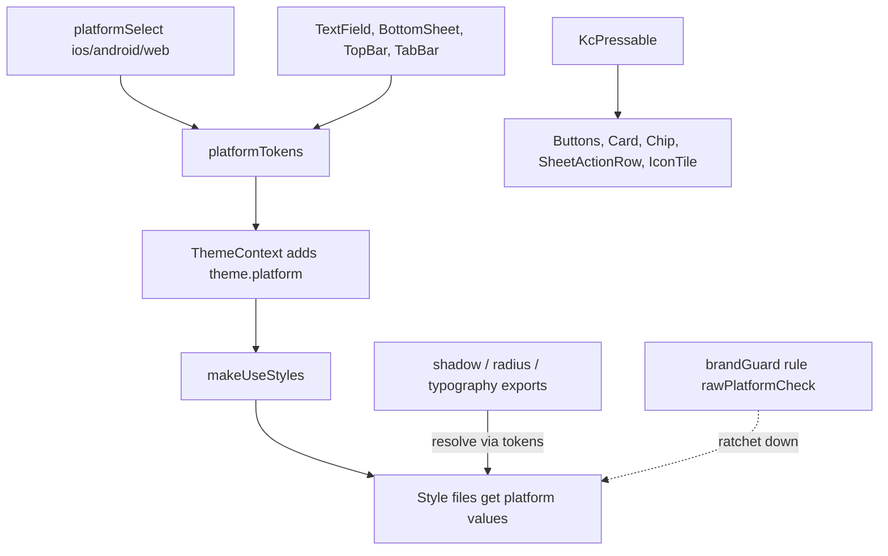

# Platform-Adaptive Native UI Design

**Status:** In progress (KC#1960)  
**Date:** 2026-11-08 / 2026-11-11  
**Authors:** Nave Sarussi, Antigravity  
**Target:** `app/apps/mobile`, `app/packages/ui`

---

## 1. Goal & Decisions

Give KC a native look on each platform: Apple style (HIG) on iOS, Material 3 on Android, and a neutral system look on web, through one generic design-system layer instead of scattered per-screen fixes.

### Key Decisions
1. **Scope:** `app/apps/mobile` and `app/packages/ui`.
2. **Platform Look:** Full native.
   - **iOS:** Follows Human Interface Guidelines (HIG): compact corner radius (10–14px), soft layered shadows, dynamic type scales, opacity-based press feedback.
   - **Android:** Follows Material Design 3 (M3): rounded corners (12–16px), elevation/surface tint, ripple press feedback.
   - **Web:** Follows neutral system accessible look.
3. **Approach:** Hybrid platform tokens, one press primitive (`KcPressable`), structural variants where values alone are insufficient, and CI ratchet enforcement (`rawPlatformCheck`).
4. **Policy Change:** Supersedes D66. Brand identity is preserved in brand colors and content; shape, depth, typography and press feedback follow each platform. System font replaces custom Rubik everywhere.

---

## 2. Architecture

### Layer 1: Platform Tokens (`@kc/ui`)
- `packages/ui/src/platform/platformSelect.ts`: `platformSelect({ ios, android, web, default })`.
- `packages/ui/src/platform/platformTokens.ts`: `PlatformTokens` containing:
  - `name`: `'ios' | 'android' | 'web'`
  - `pressFeedback`: `'opacity' | 'ripple' | 'none'`
  - `radius`: `{ xs, sm, md, lg, xl, full }`
  - `shadow`: `{ card, modal, glow }`
- `ThemeContext`: `ThemeContextValue` exposes `platform: PlatformTokens`, fed into `makeUseStyles`.

### Layer 2: Guardrails & Ratchets
- `brandGuardRules.ts`: `rawPlatformCheck: /\bPlatform\.(?:OS|select)\b/g`.
- `brand-guard.baseline.json`: Frozen ratchet baseline that only goes down.
- Admin surfaces must remain 100% clean of raw platform checks.

---

## 3. Rollout Plan
1. **Phase 1 (Foundation):** `platformSelect`, `platformTokens`, theme injection, `rawPlatformCheck` guard rule and docs.
2. **Phase 2 (Tokens & Typography):** Shadows, radius, and typography routing through platform tokens; system font replaces Rubik.
3. **Phase 3 (Press Primitive):** `KcPressable` with platform ripple/opacity, kit components move onto it.
4. **Phase 4 (Components):** Platform variants for `TextField`, `BottomSheet`, `TopBar`, and `TabBar`.
